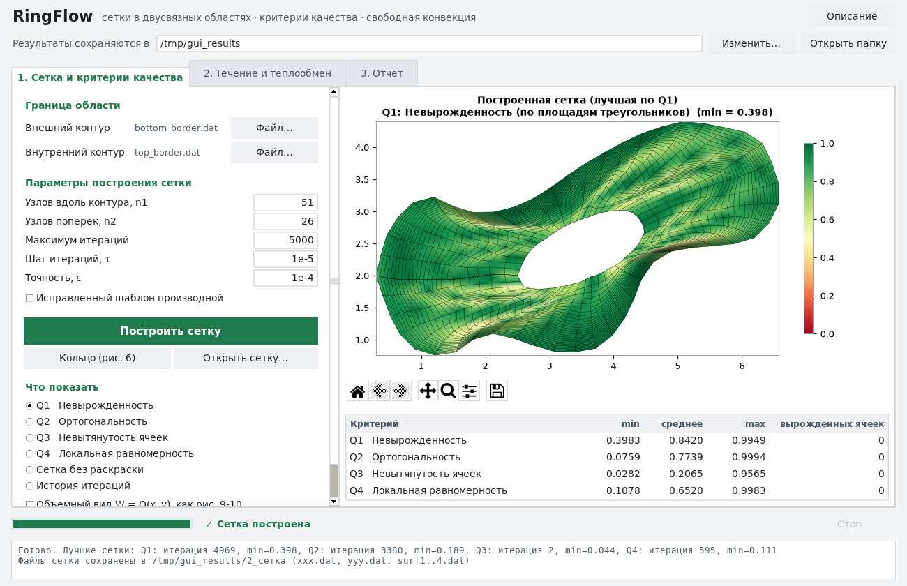
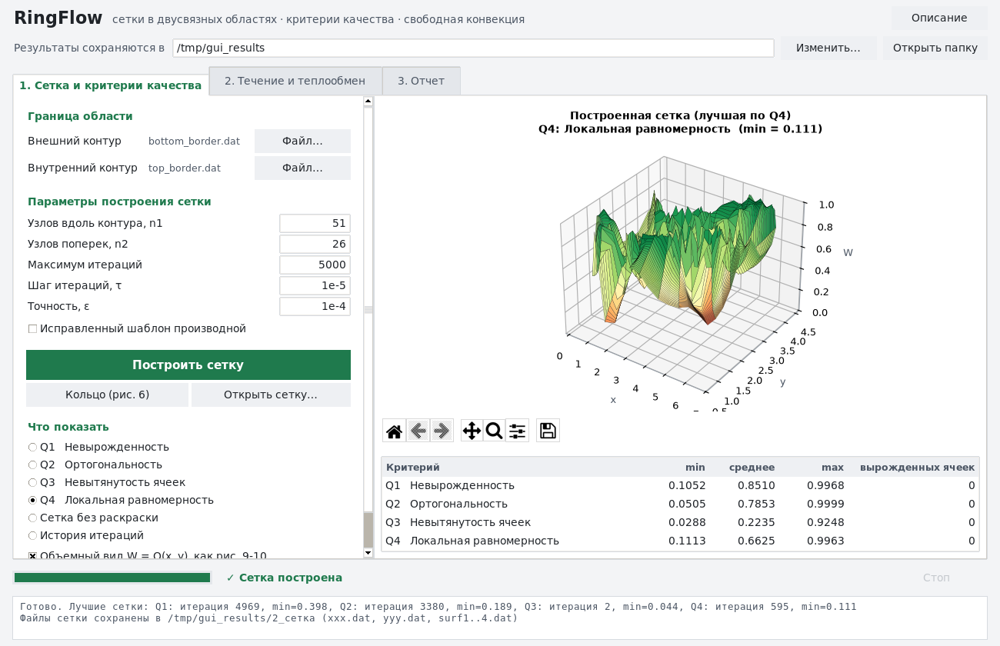
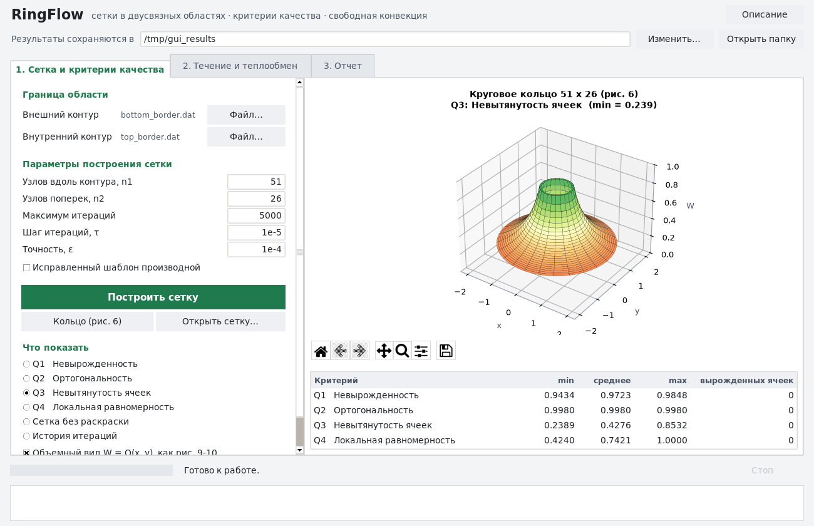
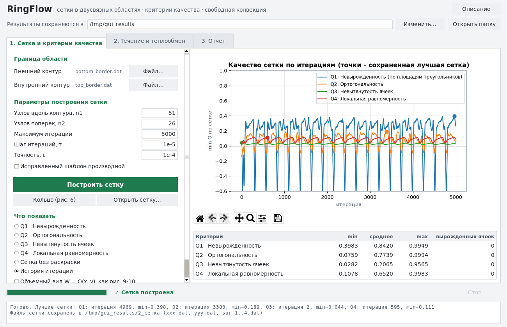
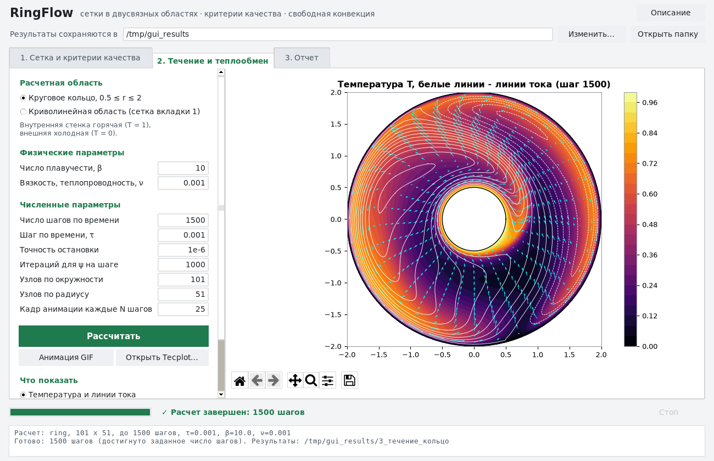
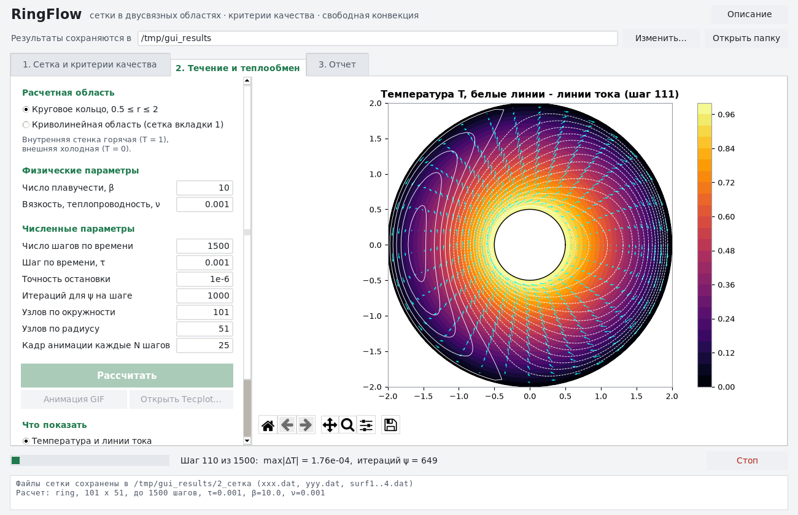
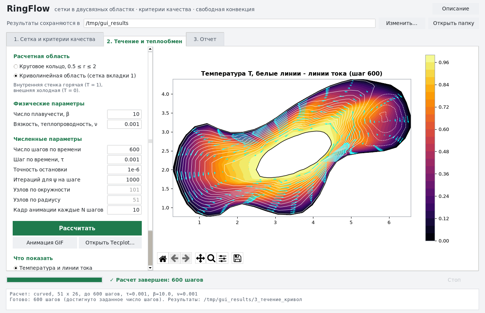
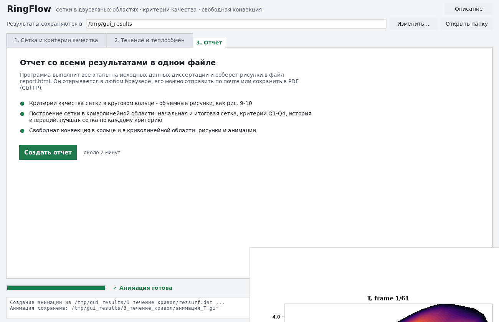

# RingFlow — комплекс программ для численного моделирования течений в двусвязных областях

Python-версия программ 2015 года, написанных на Fortran
(папка `!проект док`). Добавлен графический интерфейс. Программа работает
как обычное Windows-приложение `RingFlow.exe`: устанавливать Python не нужно.

Комплекс решает три задачи:

1. **Расстановка точек на границе.** На внешнем и внутреннем контуре
   криволинейной области расставляется по 51 точке (программа `interp.for`).
2. **Построение сетки и оценка ее качества.** В двусвязной области строится
   криволинейная сетка 51 × 26. Для этого итерационно решаются эллиптические
   уравнения методом переменных направлений. Качество сетки оценивается по
   четырем критериям (программа `Setka_ED2_II.for`).
3. **Свободная конвекция вязкой жидкости.** Решаются уравнения для функции
   тока ψ, вихря ω и температуры T в криволинейных координатах, в круговом
   кольце и в криволинейной области (программы `Dvizh_psi_om_Kolc*.for`).

---

## 1. Как скачать и запустить

1. Откройте страницу **Releases** этого репозитория (справа на главной
   странице GitHub) и скачайте файл **`RingFlow_Windows.zip`**.
2. Распакуйте архив: правая кнопка мыши → «Извлечь все…».
3. Откройте распакованную папку и запустите **`RingFlow.exe`**.

> **Если Windows показывает «Система Windows защитила ваш компьютер»**,
> нажмите «Подробнее» → «Выполнить в любом случае». Это предупреждение
> появляется для любых программ без платной цифровой подписи.
>
> **Первый запуск** занимает около минуты: программа один раз готовит
> вычислительное ядро. Следующие запуски проходят быстро.

Результаты сохраняются в папку **`Документы\RingFlow_результаты`**. Папку
можно сменить кнопкой «Изменить…» вверху окна. Кнопка «Открыть папку»
открывает ее в Проводнике. Кнопка «Описание» открывает этот текст.

---

## 2. Вкладка «1. Сетка и критерии качества»



**Что делать:**

1. Слева уже указаны внешний и внутренний контуры области (исходные данные
   диссертации). Можно выбрать свои файлы кнопкой «…». Формат файла: две
   колонки чисел `x y`, одна точка в строке, контур замкнут (первая точка
   совпадает с последней).
2. При необходимости измените параметры:

| Параметр | Значение по умолчанию | Смысл |
|---|---|---|
| Узлов вдоль контура (n1) | 51 | число узлов сетки вдоль границы |
| Узлов поперек (n2) | 26 | число узлов от внешней границы к внутренней |
| Максимум итераций | 5000 | сколько итераций сглаживания сетки выполнить |
| Шаг итераций τ | 1e-5 | шаг метода установления (больше — быстрее, но возможна неустойчивость) |
| Точность ε | 1e-4 | остановка, если узлы почти перестали двигаться |

3. Нажмите зеленую кнопку **«Построить сетку»** (около 10 секунд). Внизу окна
   виден ход итераций. Кнопка **«Стоп»** (внизу справа) прерывает расчет.

**Что показывается.** В блоке «Показать» выберите критерий качества. Сетка
раскрашивается: зеленое — хорошие ячейки, красное — плохие. В таблице под
рисунком приведены min, среднее и max значения всех критериев и число
вырожденных ячеек. Галочка **«Объемный вид W = Q(x, y)»** показывает
критерий как поверхность, как на рис. 9–10 диссертации:



Кнопка **«Кольцо (рис. 6)»** показывает критерии для расчетной сетки
в круговом кольце:



**«История итераций»** показывает, как меняется худшее (минимальное)
значение каждого критерия по ходу построения сетки. Точками отмечены
итерации, на которых сохранена лучшая сетка по каждому критерию.



Список **«Сетка»** позволяет выбрать лучшую сетку по
одному из критериев или сетку последней итерации.

### Критерии качества сетки

Каждая ячейка с вершинами 1, 2, 3, 4 разбивается диагоналями на
треугольники 123, 134, 124, 234 (рис. 1 диссертации). Площади треугольников:
S₁₂₃ = ½[(x₂−x₁)(y₃−y₁) − (x₃−x₁)(y₂−y₁)] и т.д.

| | Критерий | Формула |
|---|---|---|
| Q1 | Невырожденность (по площадям треугольников) | 2·min(S₁₂₃, S₁₃₄, S₁₂₄, S₂₃₄) / S_ячейки |
| Q2 | Ортогональность | минимальный синус угла ячейки |
| Q3 | Невытянутость ячеек | min длины стороны / max длины стороны |
| Q4 | Локальная равномерность | min(S / S_ср, S_ср / S) |

Все критерии лежат в пределах от 0 до 1: значение 1 соответствует идеальной
ячейке, значение 0 и меньше — вырожденной (вывернутой) ячейке. Для каждого
критерия программа запоминает сетку, у которой худшая ячейка лучше всего
(принцип «максимин»). Эта сетка записывается в файлы.

**Файлы результатов** (папка `2_сетка`):

* `xxx.dat`, `yyy.dat` — координаты лучшей сетки по Q1 (используются на вкладке 2);
* `surf1.dat` … `surf4.dat` — лучшая сетка по каждому критерию вместе со значениями критерия (формат Tecplot);
* `mesh_result.npz` — все результаты (для Python).

---

## 3. Вкладка «2. Течение и теплообмен»



**Что делать:**

1. Выберите **область**:
   * *Круговое кольцо* 0.5 ≤ r ≤ 2. Внутренняя стенка горячая (T = 1),
     внешняя — холодная (T = 0).
   * *Криволинейная область* — используется сетка, построенная на вкладке 1.
     Если сетка еще не построена, используется исходная сетка диссертации.
2. Задайте **параметры**. Чтобы получить другие результаты, меняйте именно их:

| Параметр | По умолчанию | Смысл |
|---|---|---|
| Число шагов по времени | 1500 | длительность моделирования; чем больше, тем ближе к установившемуся режиму |
| Шаг по времени τ | 0.001 | при слишком большом τ расчет становится неустойчивым |
| Число плавучести β | 10 | интенсивность подъемной силы; чем больше β, тем сильнее конвекция |
| Вязкость / теплопроводность ν | 0.001 | коэффициент диффузии для вихря и температуры |
| Точность (остановка) | 1e-6 | расчет останавливается, когда температура перестает меняться |
| Итераций для ψ на шаге | 1000 | максимум итераций Зейделя для уравнения функции тока |
| Узлов по окружности / по радиусу | 101 / 51 | размер сетки (только для кольца) |
| Сохранять кадр каждые N шагов | 25 | как часто записывать кадр для анимации |

3. Нажмите зеленую кнопку **«Рассчитать»**. 1500 шагов в кольце занимают
   около 1 минуты. Во время расчета рисунок обновляется, а внизу окна видны
   номер шага и прогресс. Кнопка **«Стоп»** прерывает расчет.

   

4. В блоке **«Показать»** выберите величину: температура с линиями тока,
   функция тока ψ, вихрь ω или модуль скорости |V|. Стрелки показывают
   направление и величину скорости.
5. Кнопка **«Анимация GIF»** собирает сохраненные кадры в
   анимацию (аналог AVI-файлов из презентации 2015 года).
6. Кнопка **«Открыть Tecplot…»** открывает результаты старых
   Fortran-программ, например `rezsurf.dat` или `surf1.dat`.



**Файлы результатов** (папки `3_течение_кольцо` и `3_течение_кривол`):

* `rezsurf.dat` — кадры X, Y, U, V, W, P(ψ), T в формате Tecplot (как в исходной программе);
* `metr_koef.dat` — метрические коэффициенты;
* `result.vtk` — для бесплатной программы ParaView;
* `result.npz` — все поля (для Python);
* `анимация_T.gif` — анимация.

Под панелью рисунка есть кнопки увеличения, перемещения и **сохранения
рисунка** (иконка дискеты). Рисунки можно сохранять в PNG, PDF или SVG
для вставки в Word.

---

## 4. Вкладка «3. Отчет»



Кнопка **«Создать отчет»** выполняет все этапы на исходных данных
(около 2 минут) и создает один файл **`report.html`**. Он открывается в любом
браузере, его можно отправить по почте или распечатать в PDF (Ctrl+P →
«Сохранить как PDF»). В отчете есть все рисунки: критерии качества (2D и 3D),
история построения сетки, лучшие сетки по каждому критерию, течение
и анимации.

---

## 5. Соответствие исходным программам и проверка

| Исходная программа (Fortran) | Модуль Python |
|---|---|
| `Dvizh_zhid/physical_area/interp.for` | `ringflow/boundary.py` |
| `Dvusv_set_dvish/Setka_ED2_II.for` (+ подпрограмма `KRIT_KA`) | `ringflow/mesh.py`, `ringflow/quality.py` |
| `Dvizh_zhid/Dvizh_psi_om_Kolc_jav.for` (кольцо) | `ringflow/convection.py`, вариант `ring` |
| `Dvizh_zhid/Dv_kv_set/Dvizh_psi_om_Kolc_jav.for` (криволинейная область) | `ringflow/convection.py`, вариант `curved` |
| `Dvizh_zhid/Dvizh_psi_om_Kolc.for` (метод переменных направлений для ψ) | `ringflow/convection.py`, вариант `ring_adi` |

Исходные Fortran-программы были скомпилированы (gfortran) и запущены на
исходных данных. Python-версия выдает **те же числа** во всех выходных
файлах (сетка, критерии, номера лучших итераций 4969 / 3380 / 2 / 595,
поля течения). Эту проверку выполняют автоматические тесты (папка `tests`),
а также программа сборки перед созданием каждой новой версии `RingFlow.exe`.

### Замечания по исходным программам

При переносе обнаружены особенности исходного кода. По умолчанию они
сохранены, чтобы результаты совпадали с исходными:

1. В производной по ξ во внутренних узлах нет множителя 0.5 (в узле на
   «шве» сетки он есть). Исправленный вариант включается галочкой
   «Исправленный шаблон производной».
2. В программе для криволинейной области строка `tmx(i,j)=0.001`
   закомментирована, то есть вязкость равна нулю. В окне программы по
   умолчанию задано ν = 0.001.
3. Итерации построения сетки не сходятся к одной сетке: примерно каждые
   270 итераций сетка ненадолго выворачивается (min Q1 < 0). Поэтому
   сохраняется лучшая сетка, а не последняя (см. «История итераций»).
4. Вариант с методом переменных направлений для ψ (`Dvizh_psi_om_Kolc.for`)
   расходится. Это незаконченный тестовый вариант (3 шага).
5. В программе для кольца метрические коэффициенты заданы аналитически
   по углу φ и радиусу r, а не по вычислительным координатам ξ, η. Масштаб
   уравнений поэтому отличается от варианта для криволинейной области.

---

## 6. Для разработчиков (запуск из Python)

```bash
pip install -r requirements.txt
python run_gui.py                  # окно программы
python -m ringflow --help          # командная строка
python -m ringflow report          # отчет report.html
python -m pytest -q                # проверка против Fortran
```

Подробное техническое описание (на английском): [README_EN.md](README_EN.md).

`RingFlow.exe` собирается автоматически на сервере GitHub
(`.github/workflows/build-windows.yml`) при каждом изменении в репозитории.
Готовый архив появляется на странице Releases.
